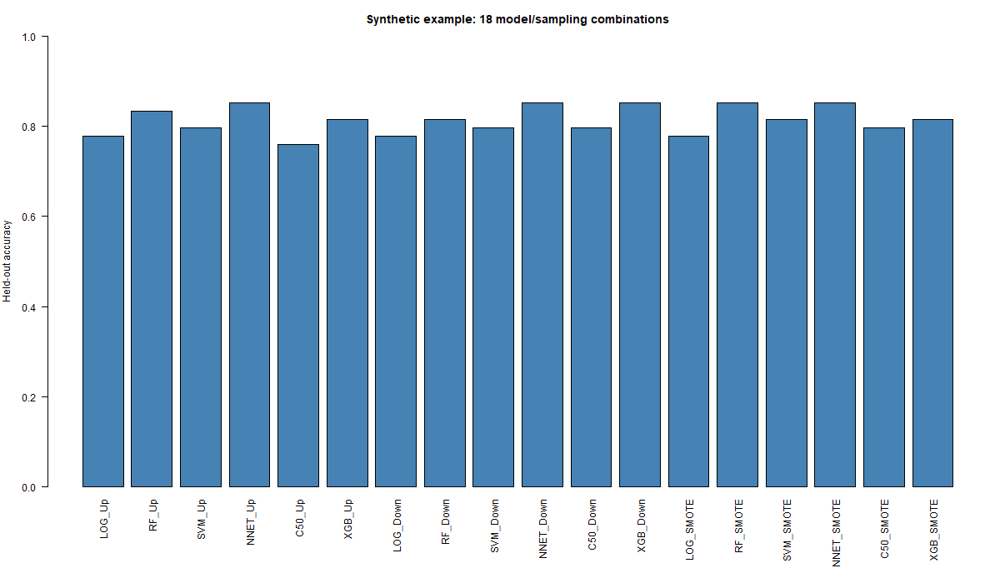

# Synthetic example: Six classifiers and three sampling strategies

Download the [repository ZIP with the example and readiness fixes](https://github.com/MPG-Git/Caret_ml_pipeline/archive/refs/heads/codex/readiness-20261107.zip),
extract it to a writable folder, and follow the setup below. These changes are
on the review branch; downloading the older default branch may omit them.
The input files and reference outputs are already included; generation is optional.

## Run and inspect

This is a standalone R workflow, not an EEGLAB plugin. Install R, then from the
extracted repository folder run:

```sh
Rscript R/01_install_libs.R
Rscript examples/synthetic/run_demo.R
```

The first command installs missing dependencies from CRAN and needs internet.
The demo itself uses only bundled input data. The reference environment used
R 4.5.1 and XGBoost 3.2.1.1. Exact package versions are in `expected/package_versions.csv`.

`data/cohort.csv` has 180 generated records, three balanced toy classes (60 each),
and six numeric features in arbitrary units. Seed 47 generates a shared
class-dependent signal plus noise. IDs are synthetic and excluded from training.

The runner fits LOG, RF, SVM, NNET, C50 and XGB with upsampling, downsampling and
SMOTE: **18 combinations**. For a quick demonstration it uses 3-fold CV, one CV
repeat, one outer split, one tuning setting and one CPU core. The normal pipeline
sets its own split seed. Expected tables and `accuracy.png` are included.

All 18 model names must appear. Held-out accuracy and AUC must be finite, within
[0,1], and within **0.15 absolute** of their reference values. This intentionally
broad installation check accommodates learner/version differences; it does not
establish identical trained models. `comparison.csv` reports each deviation.
The reference accuracies are roughly 0.76-0.85. A single outer split gives no
repeat-based confidence interval, so those summary entries may be NA.



Recreate inputs with `Rscript examples/synthetic/generate_data.R new_cohort.csv`.
For another run, supply a NEW folder: `Rscript examples/synthetic/run_demo.R demo_run_2`.

## What counts as success

A successful run prints `PASS` and writes `PASS.txt` and `comparison.csv` into
the new output folder. Errors and mismatches stop the runner without a PASS file.
Open the CSV comparison and compare your plots with `expected/`.
The included reference outputs came from actual runs on November 7, 2026.

The default output is this example's `output/` directory. Existing output folders
are refused so a previous result cannot be mistaken for a fresh run.

If a comparison fails, inspect the reported metric and confirm that you used
these bundled files, this repository version, and the listed dependencies.
Do not replace the reference with the failing result. `SHA256SUMS.json` records
input/reference file hashes for download-integrity checks. All input data are
generated; no participant recordings or personal data are included. The supplied
generators refuse to overwrite an existing destination.

These examples check the illustrated installation and workflow, not every menu
item or scientific validity for a particular study. Reference plots may render
differently with another operating system or graphics version.
